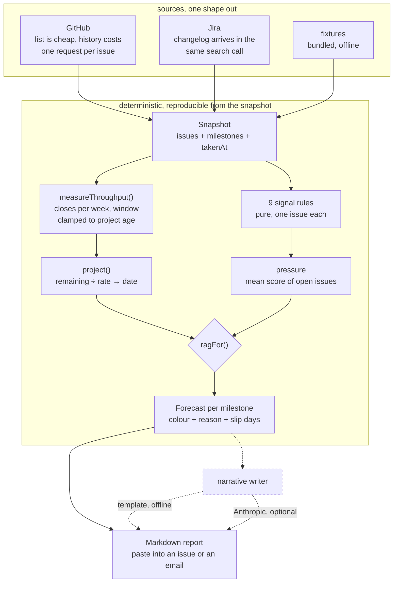

# delivery-risk-radar

Reads your GitHub or Jira issues and writes a weekly delivery-risk report: per-issue signals, and a milestone slip projected from **measured throughput** rather than from how the team feels about it.

An optional LLM writes the summary paragraph. It cannot move a single number, and there is a test that proves it.

```
npm install && npm run demo
```

## Why this exists

I have run delivery across 25-plus programmes, and the question is always the same one: *are we going to make it?* The usual way to answer it is to ask the team, and the answer is reliably optimistic right up until it is not. Not because anyone is lying — because each person can see their own issue is fine and nobody is dividing the remainder by the rate.

So this does the division. It counts what actually closed per week over a trailing window, divides what is left by that, and compares the result to the stated date. That is cruder than a planning session and much harder to argue with, and it catches the specific failure a status meeting always misses: a milestone where every individual issue looks healthy and there is simply more left than the measured rate can deliver. There is nothing to point at in that meeting, which is exactly why it gets missed.

The per-issue signals are the ones I have watched actually precede a slip. Most are about *movement*, not size. A big issue moving steadily is fine; a small one that has not moved in two weeks is someone blocked on something they have not said out loud yet.

## Architecture



The dashed path is the LLM. It hangs off the end, after every number is already decided, and nothing returns from it.

## Quick start

```bash
git clone https://github.com/krunalp2801/delivery-risk-radar
cd delivery-risk-radar
npm install
npm test          # 123 tests, no credentials needed
npm run demo      # full report from a bundled snapshot
```

Against your own project:

```bash
export GITHUB_REPO=owner/name
export GITHUB_TOKEN=ghp_...            # optional for public repos, much higher rate limit
npm run report                          # Markdown to stdout
npm run report -- --timeline            # accurate history, one request per issue
npm run report -- --one-line            # for a Slack message or a cron log
npm run report -- --explain             # the rules, and why each one exists
```

Pipe it straight where the conversation already happens:

```bash
npm run report > weekly.md
npm run report | gh issue comment 42 --body-file -
```

### What the report looks like

```
| | Milestone | Due | Open | Closed | Throughput | Projected | Slip |
|---|---|---|---|---|---|---|---|
| RED | v2.1 Checkout | 2026-10-02 | 11 | 4 | 1/wk | 2026-12-15 | +74d late |
| GREEN | v2.0 Hardening | 2026-08-30 | 0 | 2 | 0/wk | 2026-08-24 | 6d early |
| GREEN | v2.2 Returns | 2026-11-15 | 2 | 4 | 1/wk | 2026-10-13 | 33d early |
```

Then, per milestone, the issues to look at and why:

```
- **#406** (93) [3-D Secure challenge flow](...) — marek
  - `stalled` In progress but no activity for 24 days.
  - `reopened` Reopened 2 times.
  - `assignee_churn` Has been held by 3 different people.
- **#404** (89) [Decide on the payment provider's retry semantics](...) — unassigned
  - `overdue` Due date passed 4 days ago.
  - `unassigned_near_due_date` Nobody assigned and the due date has already passed.
  - `discussion_without_movement` 34 comments and nothing for 11 days, which usually
    means an unresolved disagreement.
```

### The signals

| Rule | What it catches |
|---|---|
| `stalled` | Started, then stopped. The most reliable early warning there is. |
| `blocked_by_open_issue` | Blocker chains. Depth is weighted above count. |
| `overdue` | Its own due date has passed. A measurement, not a prediction. |
| `scope_added_after_start` | The estimate everyone is quoting predates the change. |
| `reopened` | Called done and was not, so the remaining work is unestimated. |
| `unassigned_near_due_date` | Unassigned only matters against a date. |
| `assignee_churn` | Three pairs of hands usually means unclear, not hard. |
| `discussion_without_movement` | A long thread and no commits is a disagreement. |
| `aging` | Weak alone, which its weight says. It earns its place by compounding. |

## Design decisions

**Throughput is measured, not estimated.** The projection divides remaining work by issues actually closed per week. No velocity, no story-point inflation, no asking anyone how it is going. The window is clamped to the age of the project, because dividing a two-week-old project's output by four weeks made every new project look doomed — that was the first bug in `throughput.ts` and it is now a test.

**When nothing is closing, the projection is `null`, not a date.** A milestone with zero throughput gets `projectedCompletion: null` and goes red with the reason *"nothing has closed in the last 4 weeks, so there is no rate to project from"*. Inventing a far-future date there would be the single most misleading thing this tool could do, because a plausible-looking date gets believed.

**The projection outranks the signals, and the signals can still escalate.** A milestone whose arithmetic says it lands three weeks late is red even if every issue in it looks healthy — "everyone is working steadily and there is too much left" is the most common way a date is missed. But a milestone whose date holds while half its work is stalled goes amber too, because that is the other way. `ragFor` is exported precisely so you can disagree with that judgement in a test rather than by reading the implementation.

**The snapshot carries the clock.** No rule ever calls `new Date()`. Everything takes `takenAt` from the snapshot, so a report is reproducible: re-run the same snapshot next month and you get the same report, which is the only way to argue about a projection after the fact. There is a test asserting that moving the snapshot time changes the answer and that the same time always gives the same answer.

**`lastActivityAt` is not `updatedAt`.** A bot relabelling fifty issues moves `updated_at` on all fifty, and a staleness check that trusts it will report a healthy project the day before it slips. The timeline pass filters bot actors out and uses the last human action instead.

**The GitHub history pass is opt-in, and says what it costs.** One list call gives you every issue but no history: GitHub cannot tell you from a list response whether an issue was reopened, when it started, or how many people have held it. That lives in the per-issue timeline, at one request each. On a 400-issue repo that is 400 requests against a 5,000/hour budget — affordable weekly, not hourly. Without `--timeline` the report is built on list data with `reopenCount` at zero, and it says so rather than quietly pretending. The version of this that silently fires 400 requests is the version that rate-limits someone mid-release.

Jira, by contrast, returns the changelog in the same search call via `expand=changelog`. Same signals, one request. That difference is not a detail; it decides what the tool can afford to do against each tracker, and it is why both adapters are here rather than just one.

**The LLM writes prose and cannot touch a number.** The narrative writer receives the finished analysis and returns a string that nothing reads back. `narrative.test.ts` runs the same snapshot through the deterministic writer and through a hostile one that insists everything is green, and asserts the forecasts, totals and unscheduled lists come out identical. This matters more here than in most places: a delivery report is read by people deciding whether to intervene, and if the summary and the table can disagree, the summary wins, because that is the bit that gets pasted into a status email.

**Markdown out, not a dashboard.** The report's job is to be pasted into a GitHub issue, a Slack canvas or a status email. A dashboard nobody opens is the failure mode.

### Trade-offs

- **The projection is linear.** A burn-up with a confidence interval would look more sophisticated and need more history than most projects have. The dominant error here is unlogged work, not the choice of curve, so the extra precision would be spurious.
- **Weights are hand-set integers, not calibrated probabilities.** They reflect how much each finding should matter. Dressing them up as likelihoods would make them look more trustworthy than they are.
- **Partial estimates are treated as no estimates.** If any open issue lacks points, the whole milestone counts issues instead. Summing only the issues that happen to have points understates the remainder, and does it invisibly.
- **Blockers on GitHub are parsed from prose.** GitHub has no blocker links, so `blocked by #12` / `depends on #12` / `waiting on #12` are read from the body. A bare `#999` is deliberately ignored: inventing a dependency graph nobody wrote is worse than missing one.
- **Pull requests are dropped.** They have a different lifecycle and would double-count throughput.
- **In-memory, one snapshot, one report.** No history is stored, so the tool cannot yet tell you that throughput is *falling*, which is a better early warning than its absolute value. That is the next thing on the list.

## What is next

- Store snapshots so throughput can be trended. A rate falling week on week is a better signal than the rate itself, and it is the main thing missing.
- Backtest mode: replay last quarter's snapshots and report what the tool would have flagged, against what actually slipped. Without this, every weight in the table above is an opinion.
- A GitHub Action that posts the report to an issue every Monday.
- Per-assignee load, because "who is holding six stalled issues" is the other question a manager asks.
- Linear and Azure DevOps sources. The `IssueSource` interface is two methods wide, which was the point.

## Development

```bash
npm test          # typecheck + 123 tests
npm run typecheck
npm run build
npm run demo
```

Tests run straight from the TypeScript sources via Node's type stripping, so
**development needs Node 22.6+**, and the source avoids TypeScript syntax that
needs a real transform — notably parameter properties.

The built output is plain JavaScript and runs on **Node 20+**. CI proves both
separately: tests on 22 and 24, and a build-plus-demo job on 20. Zero runtime
dependencies; the optional Anthropic call is a `fetch`.

MIT licensed.

---

Built by Krunal Patel, part of the Weekly Build series. More at https://www.krunal.de
